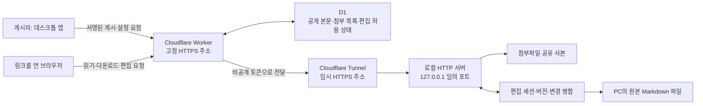
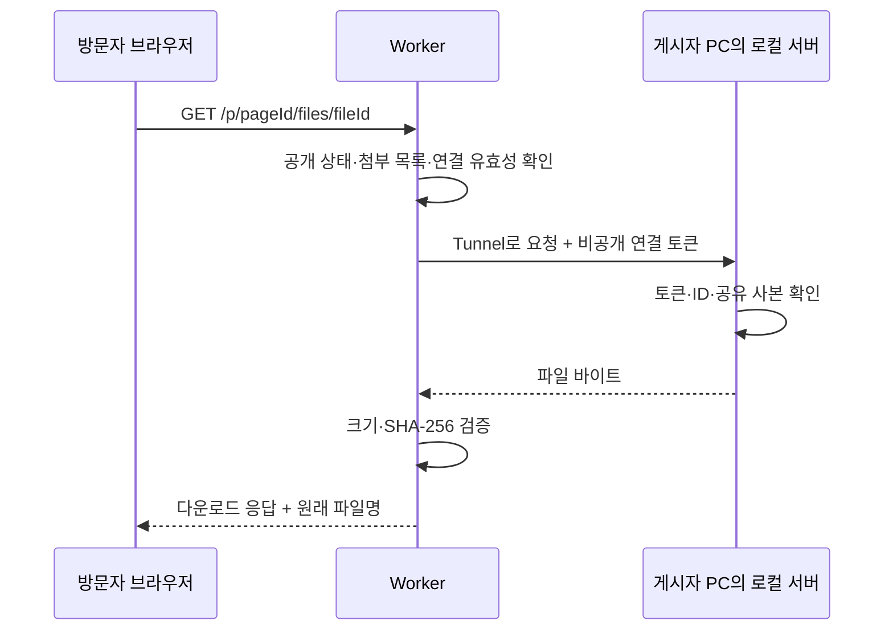

# 다른 앱에 공유 페이지·첨부파일·공동 편집 링크를 구현하는 방법

작성일: 2026-10-31
기준 구현: 이 저장소의 **Obsion**, 참고 구현: **Lithos**

이 문서는 다른 앱에 다음 기능을 붙이기 위한 설계·구현 안내다.

1. 문서를 웹 페이지로 공개하는 링크 만들기
2. 링크를 연 사람이 첨부파일 다운로드하기
3. 게시자가 허용하면 여러 사람이 브라우저에서 함께 편집하기
4. 수정 내용을 게시자의 PC에 있는 원본 파일에 저장하기

현재 Obsion의 실행 코드와 검증 결과를 예제로 사용한다. 특정 편집기나 앱 이름이 달라도, 아래의 역할과 HTTP 계약을 구현하면 같은 구조를 적용할 수 있다.

## 1. 공유 링크가 하는 일

공유 링크는 인터넷에서 접근할 수 있는 **HTTPS 주소와 문서 ID**를 조합한 것이다.

```text
https://share.example.com/p/문서ID
```

브라우저가 이 주소로 요청하면 서버가 문서 ID를 찾아 공개 본문을 HTML로 돌려준다. 파일 다운로드와 편집도 같은 문서 ID 아래에 별도의 경로를 둔다.

| 기능 | 주소 예시 | 서버가 확인할 것 |
| --- | --- | --- |
| 문서 읽기 | `/p/{pageId}` | 현재 공개 중인 문서인지 |
| 파일 받기 | `/p/{pageId}/files/{fileId}` | 그 문서에 포함된 파일인지, 원본 PC가 연결됐는지 |
| 편집 화면 | `/p/{pageId}/edit` | 게시자가 공동 편집을 켰는지 |
| 편집 참여 | `/api/pages/{pageId}/collab/login` | 편집 암호와 참여 제한 |
| 변경 동기화 | `/api/pages/{pageId}/collab/updates` | 유효한 편집 세션과 문서 버전인지 |

`pageId`는 추측하기 어려운 난수로 생성한다. 원본 파일 경로나 사용자 이메일을 ID로 사용하지 않는다. 현재 Obsion은 16바이트 난수를 32자리 16진수로 표현한다.

**읽기 링크를 안다는 사실과 편집 권한을 가진다는 사실은 별도로 확인한다.** 읽기는 공개하고, 편집은 게시자가 켠 문서에 한해 암호와 세션으로 허용한다.

## 2. 먼저 정할 것: 어디에 원본과 파일을 둘 것인가

| 구성 | 문서·파일 위치 | PC가 꺼졌을 때 | 구현 시 필요한 부분 |
| --- | --- | --- | --- |
| 클라우드 보관 | 서버 DB와 파일 저장소 | 서버에 보관한 내용 제공 가능 | 업로드·저장소·다운로드 권한 |
| 로컬 PC 보관 | 게시자의 PC | PC에서 제공하는 기능 중단 | 로컬 HTTP 서버·외부 연결·상태 안내 |
| 현재 Obsion 구성 | 공개 본문은 D1, 첨부와 편집 원본은 PC | 공개 본문은 읽기 가능, 다운로드·편집은 중단 | Worker + D1 + 로컬 서버 + Tunnel |

현재 구성은 첨부파일을 R2에 보관하지 않는다. 따라서 R2 활성화가 필요하지 않다. Workers와 D1 사용량에는 해당 계정의 현재 요금제 한도가 적용된다.

다른 앱에서도 문서 읽기, 파일 다운로드, 원본 쓰기를 각각 어디에서 처리할지 먼저 정하면 나머지 설계가 명확해진다.

## 3. 현재 Obsion의 전체 구조



역할은 다음과 같다.

- **데스크톱 앱:** 공개 범위 선택, 미리보기, 파일 선택, 게시·중지, 공동 편집 설정
- **Worker:** 고정 주소 제공, 게시자 서명 확인, 공개 문서 조회, 로컬 PC로 요청 전달
- **D1:** 공개 본문과 메타데이터, 현재 로컬 연결 정보 보관
- **로컬 서버:** 승인된 파일 전송, 편집 인증, 원본 파일 저장
- **Tunnel:** 외부 요청을 로컬 서버까지 중계
- **브라우저 편집기:** 로그인, 입력 변경 전송, 다른 참여자의 변경 반영

원본 경로, 개인 서명 키, PIN 해시, 백업은 로컬 앱의 비공개 데이터에 둔다.

## 4. 고정 링크와 임시 터널을 연결하는 방법

Quick Tunnel의 주소는 다시 연결할 때 바뀔 수 있다. 현재 Obsion은 사용자에게 **Worker의 고정 주소**를 전달하고, Worker가 현재 터널 주소를 찾아 요청을 전달한다.

```text
사용자에게 전달하는 주소
https://share.example.com/p/고정된문서ID

앱이 실행되는 동안의 내부 연결 주소
https://임의이름.trycloudflare.com
```

앱은 터널이 연결되면 서명된 요청으로 다음 정보를 Worker에 등록한다.

```json
{
  "origin": "https://임의이름.trycloudflare.com",
  "token": "실행할 때 생성한 비공개 연결 토큰"
}
```

현재 구현은 30초마다 연결을 갱신하고 Worker는 90초 이내에 갱신된 연결만 사용한다. 터널 주소가 바뀌어도 문서와 파일의 외부 링크는 유지된다. 연결 토큰과 터널 주소는 공개 페이지나 문서 조회 API에 포함하지 않는다.

Cloudflare 공식 안내에 따르면 Quick Tunnel은 계정·도메인 없이 임시 주소를 제공하지만 가동 시간을 보장하지 않는다. 장기간 안정적인 외부 연결이 필요하면 운영 환경에 맞는 Tunnel과 도메인 구성을 검토한다. [Cloudflare Quick Tunnels 안내](https://developers.cloudflare.com/tunnel/get-started/quick-tunnels/)

### 앱에서 터널을 시작하는 순서

1. 로컬 HTTP 서버를 `127.0.0.1`의 사용 가능한 임의 포트에 연다.
2. 실행 중에만 쓰는 충분히 긴 연결 토큰을 생성한다.
3. `cloudflared`를 자식 프로세스로 시작한다.
4. 임시 URL과 실제 터널 연결 완료를 모두 확인한다.
5. Worker를 통해 로컬 서버의 준비 상태를 확인한다.
6. 연결 정보를 주기적으로 갱신한다.
7. 앱을 완전히 종료할 때 터널과 로컬 서버도 종료한다.

현재 구현은 공유가 활성화된 동안 자동 잠자기를 방지한다. 사용자가 직접 잠자기를 선택하거나 PC·네트워크를 종료하면 다운로드와 편집은 중단된다.

## 5. 공유 페이지 만들기

### 5.1 공개용 본문 준비

현재 Obsion은 게시 전에 다음 처리를 한다.

- YAML 메타데이터를 공개 본문에서 제외한다.
- 숨김 주석을 제거한다.
- `publish: false`인 노트는 게시를 거부한다.
- 연결된 다른 노트나 파일을 자동으로 따라가서 공개하지 않는다.
- 제목·설명·테마·본문·선택한 첨부 목록을 미리보기로 확인한다.

다른 앱에서도 **공개할 사본**을 먼저 만들고 사용자가 확인한 뒤 게시하도록 구성한다.

### 5.2 미리보기와 실제 게시 내용 일치시키기

공개 데이터의 정해진 JSON 표현으로 SHA-256 digest를 만든다.

```text
digest = SHA256(정해진 필드 순서로 직렬화한 공개 데이터)
```

미리보기 후 원본이나 첨부 목록이 바뀌면 digest가 달라진다. 게시 요청 전에 다시 비교하고, 달라졌으면 새 미리보기를 요청한다. 서버도 같은 방식으로 digest를 계산한다.

이때 클라이언트와 서버의 필드 순서, 빈 첨부 목록 처리, 문자열 정규화 규칙을 동일하게 정해야 한다. 현재 Obsion의 구현은 [공개 본문 준비 코드](../electron/public-note.cjs)와 [Worker 게시 처리](../publish-service/worker/cloudflare.ts)를 함께 확인하면 된다.

### 5.3 게시 권한 확인

공개 문서를 만드는 API에는 게시자 인증이 필요하다. 현재 Obsion은 앱에 개인 키를 보관하고, 서버에 등록된 공개 키로 Ed25519 서명을 검증한다.

서명할 메시지는 아래 항목을 줄바꿈으로 연결한다.

```text
HTTP 메서드
요청 경로
요청 시각
요청별 난수 nonce
요청 본문
```

서버는 서명, 시간 범위, nonce 중복을 검사한다. 재사용된 nonce는 거절한다. 개인 키는 웹 페이지나 배포 자산에 넣지 않는다.

### 5.4 링크를 유지하며 갱신하기

처음 게시할 때 만든 `pageId`를 로컬 공유 기록에 저장한다. 업데이트는 같은 ID에 쓰고, 공유 중지는 해당 ID를 삭제하거나 비활성화한다.

서버 응답이 유실돼도 관리할 수 있도록 **업로드 전에 문서 ID와 관리 기록을 먼저 저장**한다. 현재 구현의 순서는 [PublishManager](../electron/publish-manager.cjs)에 있다.

## 6. 첨부파일 다운로드 구현

### 6.1 사용자가 선택한 파일만 복사하기

앱의 네이티브 파일 선택 창을 통해 파일을 고른다. 브라우저 렌더러에는 원래 절대 경로를 넘기지 않고 다음 메타데이터만 전달한다.

```json
{
  "id": "파일을 식별하는 64자리 값",
  "name": "공유 자료.pdf",
  "size": 123456,
  "sha256": "파일 내용의 SHA-256"
}
```

현재 Obsion은 선택한 내용을 로컬 공유 폴더에 복사해 사본을 만든다. 이후 원본 파일을 수정하거나 삭제해도 공유 사본은 유지된다. 변경한 파일을 공개하려면 다시 선택하고 공개 페이지를 업데이트한다.

현재 제한은 **파일당 5MiB, 최대 10개, 합계 10MiB**다. 이는 Obsion에서 정한 값이다. 다른 앱에서 한도를 늘릴 때는 읽기·전송·해시 검증 과정의 메모리 사용량도 함께 조정한다.

### 6.2 다운로드 요청 처리



다운로드 응답은 파일을 실행하는 페이지 대신 저장할 첨부로 전달한다.

```http
Content-Type: application/octet-stream
Content-Disposition: attachment; filename="download"; filename*=UTF-8''...
X-Content-Type-Options: nosniff
Cache-Control: no-store
```

로컬 서버는 문서 ID와 파일 ID만 받아 승인된 공유 폴더에서 파일을 찾는다. 사용자가 보낸 `../../...` 같은 경로를 파일 경로로 사용하지 않는다. 현재 구현은 심볼릭 링크도 거부한다.

### 6.3 삭제·중지·오프라인 처리

| 상태 | 현재 동작 |
| --- | --- |
| 문서에서 첨부 제거 | 이전 다운로드 경로는 404 |
| 문서 공유 중지 | 문서·첨부 다운로드 모두 404 |
| PC 또는 앱 종료 | 공개 본문은 읽을 수 있고 다운로드는 503 안내 |
| 앱 재시작·터널 재연결 | 새 연결 등록 후 같은 외부 다운로드 경로 사용 |

현재 Obsion은 공유를 중지하면 로컬 공유 사본도 정리한다. 이미 다른 사람이 내려받은 파일은 회수할 수 없으므로, 공개 전에 파일 내용을 확인하는 UI가 필요하다.

## 7. 링크를 받은 사람이 편집하게 만들기

편집 가능한 링크에는 아래 다섯 부분이 필요하다.

1. 게시자의 명시적인 편집 허용
2. 참여자 인증과 세션
3. 브라우저 편집기
4. 변경 버전과 동시 수정 병합
5. 원본 파일의 안전한 저장과 복구

### 7.1 게시자가 편집을 켜는 흐름

현재 Obsion의 UI 흐름은 다음과 같다.

```text
공유 링크 만들기
→ 숫자 4자리 편집 암호 입력
→ 공동 편집 켜기
→ 링크와 암호를 참여자에게 전달
```

켜기 전에 원본과 공개본이 일치하는지 검사하고 원본을 비공개 폴더에 백업한다. 이후 해당 노트는 데스크톱에서 읽기 전용으로 표시하며 일반 수정·이름 변경·삭제를 막는다. 소유자도 브라우저 링크에서 함께 편집할 수 있다.

이렇게 하면 데스크톱의 별도 저장 로직과 브라우저 공동 편집기가 서로 다른 본문을 덮어쓰는 상황을 줄일 수 있다.

### 7.2 암호와 편집 세션

현재 구현은 PIN 원문 대신 **salt와 scrypt 해시**를 로컬에 저장한다. PIN은 URL에 넣지 않고 HTTPS JSON 요청 본문으로 전달한다.

PIN이 맞으면 무작위 세션 토큰과 참여자 ID를 발급한다. 이후 변경 요청은 그 토큰으로 인증한다. 현재 정책은 다음과 같다.

| 항목 | 현재 설정 |
| --- | --- |
| 편집 PIN | 숫자 4자리 |
| 잘못된 PIN 시도 | 문서·요청 IP 기준 5회 후 1분 제한 |
| 편집 세션 | 메모리에 보관, 최대 8시간 |
| 참여 인원 | 문서당 최대 32명 |
| 앱 재시작 | 참여자는 PIN으로 다시 인증 |

4자리 PIN은 현재 앱의 참여 방식이다. 더 민감한 문서를 다루는 앱에서는 사용자 계정, 초대 대상, 더 강한 인증 정책을 설계에 포함한다.

### 7.3 문서 전체를 덮어쓰면 생기는 문제

Alice와 Bob이 같은 버전의 본문을 열었다고 가정한다.

```text
기준 본문: 안녕하세요
Alice: 맨 앞에 "Alice: " 추가
Bob: 맨 뒤에 "!" 추가
```

두 브라우저가 수정한 전체 본문을 각각 저장하면 마지막 요청이 앞선 수정을 덮어쓸 수 있다. 공동 편집에서는 각자의 변경과 그 변경의 기준 버전을 관리해야 한다.

### 7.4 현재 구현의 OT 처리

현재 Obsion은 `@codemirror/collab`을 사용한다. 중심이 되는 편집 상태는 원본 PC에 있고, 그 상태가 현재 버전과 승인한 변경 이력을 관리한다.

```text
브라우저: 기준 버전 + 아직 승인되지 않은 변경 전송
원본 PC: 그 버전 이후의 변경 위로 새 변경을 재배치
원본 PC: 병합 결과를 저장하고 버전 증가
브라우저: 승인된 변경을 받아 자신의 문서에 반영
```

사용하는 주요 API는 다음과 같다.

| API | 역할 |
| --- | --- |
| `collab` | 브라우저의 공동 편집 상태 구성 |
| `getSyncedVersion` | 서버와 동기화된 기준 버전 조회 |
| `sendableUpdates` | 아직 승인받지 못한 로컬 변경 조회 |
| `rebaseUpdates` | 서버에서 오래된 기준 버전의 변경을 재배치하고 중복 제외 |
| `receiveUpdates` | 승인된 변경을 브라우저 편집기에 반영 |

알고리즘의 API 의미는 [CodeMirror 공식 소스](https://github.com/codemirror/collab/blob/main/src/collab.ts)에서 확인할 수 있다. 현재 앱의 사용 코드는 [브라우저 편집기](../src/ShareEditor.ts)와 [로컬 공동 편집 처리](../electron/shared-editing.cjs)에 있다.

### 7.5 변경 요청의 예

아래는 구조를 설명하는 예시다. 실제 `changes` 값은 CodeMirror의 `ChangeSet.toJSON()`으로 생성한다.

```json
{
  "epoch": "이번 편집 방의 식별자",
  "version": 12,
  "updates": [
    { "changes": "ChangeSet.toJSON()으로 만든 값" }
  ]
}
```

서버는 참여자 ID를 세션에서 정한다. 클라이언트가 임의로 지정한 다른 사람의 ID를 신뢰하지 않는다. 앱 재시작이나 편집 방 재설정으로 epoch가 바뀌면 이전 세션의 변경을 무조건 적용하지 않는다.

현재 브라우저는 입력 후 약 350ms부터 저장을 시도하고, 다른 참여자의 변경은 2초 간격으로 가져온다. 연결 실패 시 미전송 입력을 지우지 않고 복사·재참여 동작을 제공한다.

### 7.6 원본 저장과 충돌 처리

원본 파일에 쓰기 전 다음을 확인한다.

1. 유효한 세션이고 공동 편집이 계속 켜져 있는가?
2. 기준 버전이 보관 중인 변경 이력 범위 안에 있는가?
3. 원본 파일이 외부 편집기에서 바뀌지 않았는가?
4. 병합한 본문이 크기와 형식 제한을 만족하는가?
5. 저장 대상이 승인한 보관함 안의 원본 노트인가?

원본이 외부에서 바뀌었다면 409 충돌로 중지하고 사용자의 입력을 보존한다. 원본 파일과 공유 기록을 갱신할 때는 실패 시 되돌릴 수 있도록 저장 순서를 정한다.

현재 Obsion은 YAML prefix를 그대로 유지하고 본문만 편집한다. 숨김 주석이 있는 본문은 편집을 켜기 전에 분리하도록 안내하며, 브라우저에서 새 YAML prefix나 숨김 주석을 추가하는 것도 제한한다. 브라우저가 새 로컬 파일을 자동으로 읽게 하지는 않는다.

### 7.7 공개 읽기 페이지와 편집 결과 맞추기

로컬 원본을 저장한 뒤 Worker에 최신 공개 본문·digest·수정 시각을 전달해 D1에 반영한다. 후속 동기화 요청에서도 최신 로컬 상태를 전달하므로 일시적인 서버 갱신 실패를 다시 처리할 수 있다.

이 구성에서는 현재 편집 방의 로컬 상태가 변경 병합의 기준이다. 앱을 종료하면 편집이 중단되고, 공개 읽기 화면에는 마지막으로 반영된 공개 본문이 남는다.

## 8. 다른 앱에 옮길 때 만들 모듈

```text
공유 UI
 ├─ 공개 미리보기·게시·중지
 ├─ 첨부파일 선택·제거
 └─ 공동 편집 켜기·끄기

신뢰할 수 있는 앱 프로세스
 ├─ ShareManager: ID·공유 기록·서명 요청
 ├─ AttachmentStore: 승인한 파일의 공유 사본
 ├─ LocalShareServer: 파일·편집 API
 ├─ TunnelManager: 실행·준비 확인·재연결·종료
 └─ CollaborationService: 인증·버전·병합·원본 저장

외부 서버
 ├─ PublicPage: HTML 읽기 화면
 ├─ PublishAPI: 게시자 인증
 ├─ DownloadProxy: 파일 권한·연결·무결성 확인
 └─ EditingProxy: 편집 허용 상태·요청 전달·공개본 갱신
```

Electron 앱은 렌더러와 메인 프로세스 사이에 제한된 IPC를 둔다. 다른 기술로 만든 앱도 같은 역할의 신뢰 경계를 둔다. 브라우저 화면에 임의 파일 읽기·쓰기나 일반 셸 실행 권한을 제공할 필요는 없다.

### 여러 사용자·여러 PC로 확장할 때

현재 Obsion은 **하나의 게시 키와 하나의 로컬 PC 호스트**를 기준으로 한다. 여러 사용자의 서비스를 만들 때는 데이터 구조를 확장해야 한다.

- 문서와 첨부에 `ownerId`를 연결한다.
- 터널 연결은 `ownerId`와 `deviceId`별로 보관한다.
- 문서 요청이 그 소유자의 호스트로만 전달되는지 검사한다.
- 게시 키 등록·교체·해제와 사용자 계정 인증을 구현한다.
- 편집 방을 처리하는 호스트와 세션 수명을 명확하게 정한다.
- 데이터 삭제, 백업, 저장량 제한과 장애 시 복구 정책을 정한다.

## 9. 단계별 구현 순서

| 순서 | 만들 기능 | 완료를 확인하는 방법 |
| --- | --- | --- |
| 1 | 문서 ID와 공개 데이터 | 비공개 필드가 공개 JSON에 없는지 확인 |
| 2 | 읽기 페이지 | 다른 브라우저에서 링크로 문서를 읽기 |
| 3 | 게시·갱신·중지 | 같은 링크 갱신, 중지 후 404 |
| 4 | 로컬 공유 사본 | 원본 파일 삭제 후에도 공유 사본 유지 |
| 5 | 로컬 서버와 Tunnel | 외부 요청이 승인한 로컬 파일에만 도달 |
| 6 | 다운로드 연결 | 파일명·크기·바이트 일치 확인 |
| 7 | 편집 허용·PIN·세션 | 잘못된 암호·만료된 세션 거부 |
| 8 | 단일 참여자 저장 | 브라우저 입력이 로컬 원본에 반영 |
| 9 | 동시 변경 병합 | 두 참여자의 수정이 모두 유지 |
| 10 | 실패·복구 | 재연결, 중복 요청, 외부 변경, 앱 재시작 확인 |

처음부터 모든 기능을 한 번에 연결하기보다, 각 단계에서 실제 HTTP 요청과 저장 결과를 확인하면서 다음 기능을 붙이면 문제 위치를 찾기 쉽다.

## 10. 현재 코드에서 찾아볼 위치

이 문서는 저장소의 `docs/` 폴더에 있으며 아래 링크는 저장소의 구현 파일을 가리킨다. `REA 실습` 폴더에도 별도 사본을 보관한다.

| 역할 | 코드 |
| --- | --- |
| 앱 공유 창 | [src/PublishDialog.tsx](../src/PublishDialog.tsx) |
| 네이티브 파일 선택·IPC | [electron/main.cjs](../electron/main.cjs), [electron/preload.cjs](../electron/preload.cjs) |
| 공개 본문과 digest | [electron/public-note.cjs](../electron/public-note.cjs) |
| 게시·관리 기록 | [electron/publish-manager.cjs](../electron/publish-manager.cjs) |
| 첨부 선택·한도 | [electron/publish-attachments.cjs](../electron/publish-attachments.cjs) |
| 로컬 HTTP 서버·터널 | [electron/attachment-host.cjs](../electron/attachment-host.cjs) |
| PIN·세션·병합·원본 저장 | [electron/shared-editing.cjs](../electron/shared-editing.cjs) |
| 브라우저 편집기 | [src/ShareEditor.ts](../src/ShareEditor.ts) |
| 공개 HTTP API | [worker/cloudflare.ts](../publish-service/worker/cloudflare.ts) |
| 읽기·편집 HTML | [worker/html.ts](../publish-service/worker/html.ts) |
| DB 마이그레이션 | [publish-service/drizzle](../publish-service/drizzle/) |
| 실제 배포 절차 | [CLOUDFLARE.md](../publish-service/CLOUDFLARE.md) |

현재 구현은 테스트 37개와 실제 배포 주소를 이용해 확인했다. 실제 파일 다운로드의 바이트 일치, 터널 종료 시 다운로드 중단, 재연결 후 같은 링크 복구, 공유 중지 후 404를 확인했다. 별도의 두 브라우저 세션에서 PIN 참여·동시 수정·로컬 원본 저장·YAML 유지·공개 본문 갱신·편집 중지도 확인했다.

## 11. 참고 자료

- [Lithos 저장소](https://github.com/beaur8-prog/lithos): 로컬 공유와 공동 편집의 참고 구현
- [Lithos 터널 관리](https://github.com/beaur8-prog/lithos/blob/main/electron/share-tunnel.cjs): 연결 준비 확인과 프로세스 관리
- [Lithos 공동 편집](https://github.com/beaur8-prog/lithos/blob/main/electron/share-collaboration.cjs): 원본 백업·세션·OT 처리
- [CodeMirror collab 공식 소스](https://github.com/codemirror/collab/blob/main/src/collab.ts): 현재 앱에서 사용하는 공동 편집 API의 구조
- [Cloudflare Quick Tunnels](https://developers.cloudflare.com/tunnel/get-started/quick-tunnels/): 임시 외부 연결의 사용법과 제한

타사 코드를 다른 앱에 직접 포함할 때는 해당 저장소의 라이선스와 사용 조건을 확인한다. 이 가이드는 역할과 통신 구조를 자신의 앱에 맞게 구현하는 데 사용할 수 있다.
